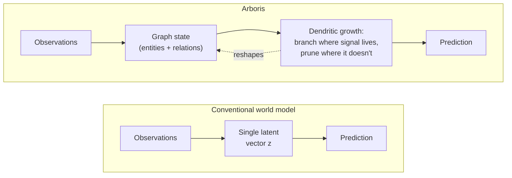
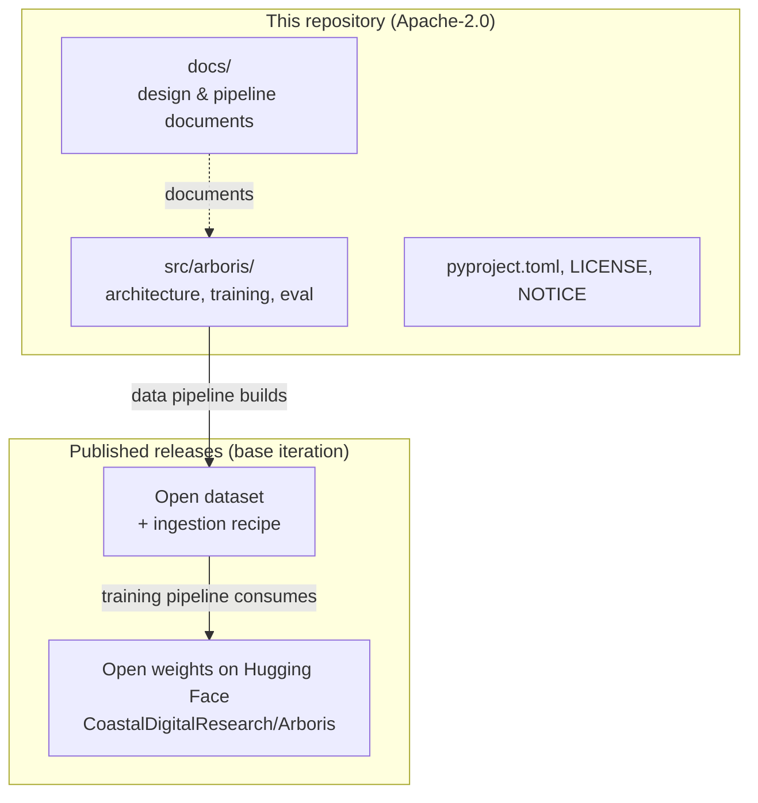
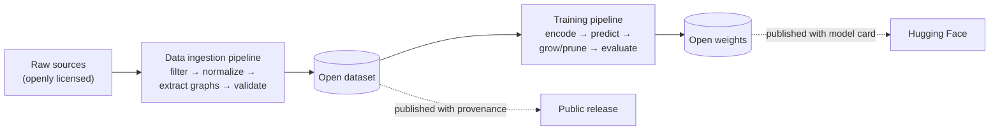

# Arboris

**A graph-based, dendritic model exploring an alternative approach to world models —
open source, open weights, and open data for the base iteration.**

> **Status:** pre-alpha, in active development. The architecture is still taking
> shape, and no trained weights have been released yet. This repository is the
> source home for the code and data recipes. Once trained models exist, Coastal
> Digital Research publishes them on Hugging Face. The diagrams and pipeline
> documents below describe the **planned design**; see the
> [status table](#project-status) for what exists today.

---

## What is Arboris?

**In plain terms:** most AI systems that try to "understand" an environment
squeeze everything they see into one big list of numbers. They predict what
happens next from that list. Arboris instead tracks the *things* in an
environment and the *relations* between them, like a map of who is connected
to what. It grows new branches of that map only where they help it predict the
world better, the way a tree grows branches toward light. The name comes from
*arbor*, Latin for tree.

**For researchers:** most world models compress state into a single latent
vector that rolls forward in time under one predictive objective. Arboris
represents state as a typed graph and grows its predictive structure
*dendritically*. It branches along the relations that carry predictive signal
instead of flattening everything into a monolithic latent. The hypothesis is
that a branching, graph-native representation captures the compositional
structure of an environment more faithfully, and degrades more gracefully,
than a fixed-width latent.

Arboris is a research direction, not a finished result. Expect the design to
change.



## Project organization

The project publishes everything in three public places: this repository (code
and recipes), the open dataset release, and the open weights release on
Hugging Face.



### Repository layout

```
src/arboris/       library code (architecture, training, eval) — WIP scaffold
  retrieval/           graph-native retrieval subsystem (implemented, reference
                       stack): evidence-graph pipeline w/ dendritic activation —
                       see docs/adr/ and docs/rfc/
.claude/skills/
  ontology-testbed/    benchmark harness: evaluate Arboris implementations on
                       masked-relation prediction over Microsoft's
                       Ontology-Playground catalogue (71 real ontologies)
docs/              design documents and diagrams
  architecture.md      components and the dendritic mechanism
  data-pipeline.md     how raw data becomes the open training dataset
  training-pipeline.md how the open dataset becomes open weights
  openness.md          the open-source / open-weights / open-data commitments
  adr/                 architecture decision records
  rfc/                 detailed designs (retrieval pipeline, activation, …)
tests/             pytest suite (PYTHONPATH=src python -m pytest)
LICENSE, NOTICE    Apache-2.0
```

## The two pipelines

Arboris has two pipelines. Each pipeline has its own document with detailed
diagrams; the short version:



- **[Data ingestion pipeline](docs/data-pipeline.md)** — filters raw, openly
  licensed source material for provenance, normalizes it, and converts it into
  graph-structured training examples. It then validates the examples and
  publishes them as an open dataset anyone can inspect or rebuild.
- **[Training pipeline](docs/training-pipeline.md)** — trains the model on the
  open dataset: it encodes observations into graph state, predicts forward,
  and grows and prunes dendritic structure. It then evaluates checkpoints and
  publishes them as open weights.

## Open by design

The base iteration of Arboris commits to openness on all three axes that
matter for reproducibility, not just the code. See
**[docs/openness.md](docs/openness.md)** for detailed coverage of each axis.

| Component | What it means | License / home | Status |
|---|---|---|---|
| **Open source** | All architecture, training, and eval code | Apache-2.0, this repo | Scaffold published |
| **Open weights** | Trained checkpoints for the base model, with model card | Hugging Face: [CoastalDigitalResearch/Arboris](https://huggingface.co/CoastalDigitalResearch/Arboris) | Not yet released |
| **Open data** | The base training dataset **and** the full recipe to rebuild it | Published with per-source provenance | In design |

Anyone should be able to retrace the entire path from raw sources to a working
model using only public artifacts.

## Project status

| Piece | State today |
|---|---|
| Package scaffold (`src/arboris/`) | ✅ published (v0.0.1, pre-alpha) |
| Design documents and diagrams (`docs/`) | ✅ this documentation set |
| Graph state + dendritic architecture code | 🔨 in active development |
| Data ingestion pipeline code | 📋 designed, not yet implemented |
| Training pipeline code | 📋 designed, not yet implemented |
| Open dataset release | ⏳ pending pipeline implementation |
| Open weights release | ⏳ pending training runs |

## Partnership

Adam Pippert develops Arboris as independent research. Coastal Digital
Research trains and publishes the models on Hugging Face:
<https://huggingface.co/CoastalDigitalResearch/Arboris>.

## License

Apache-2.0. See [`LICENSE`](LICENSE) and [`NOTICE`](NOTICE).
