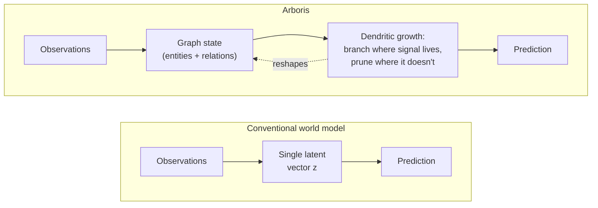
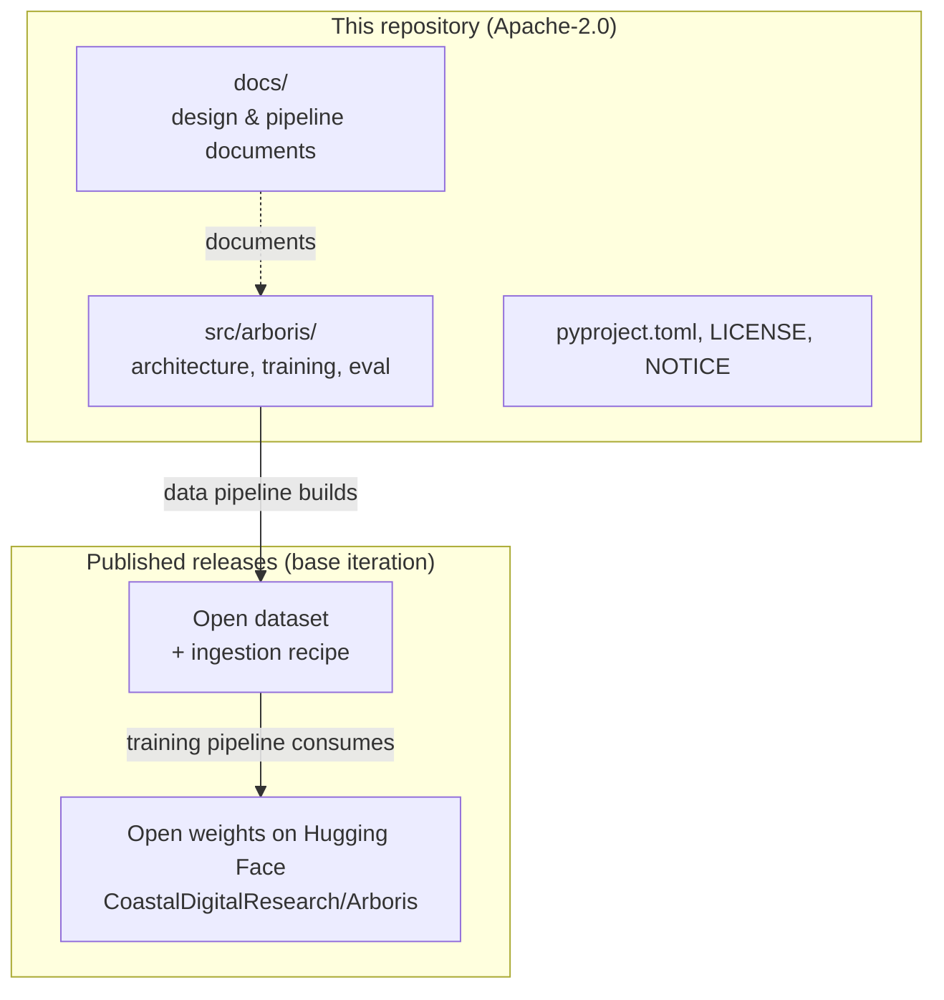
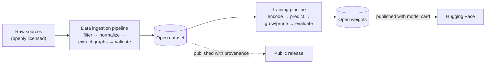

# Arboris

**A graph-based, dendritic model exploring an alternative approach to world models —
open source, open weights, and open data for the base iteration.**

> **Status:** pre-alpha, in active development. The architecture is still taking
> shape and no trained weights have been released yet. This repository is the
> source home for the code and data recipes. Trained models, once they exist,
> are published by Coastal Digital Research on Hugging Face. The diagrams and
> pipeline documents below describe the **planned design**; see the
> [status table](#project-status) for what exists today.

---

## What is Arboris?

**In plain terms:** most AI systems that try to "understand" an environment
squeeze everything they see into one big blob of numbers and predict what
happens next from that blob. Arboris instead keeps track of the *things* in an
environment and the *relationships between them* — like a map of who is
connected to what — and it grows new branches of that map only where they help
it predict the world better, the way a tree grows branches toward light. The
name comes from *arbor*, Latin for tree.

**For researchers:** most world models compress state into a single latent
vector that rolls forward in time under one predictive objective. Arboris takes
a different route: it represents state as a typed graph and grows its
predictive structure *dendritically* — branching along the relations that carry
predictive signal rather than flattening everything into a monolithic latent.
The bet is that a branching, graph-native representation captures the
compositional structure of an environment more faithfully, and degrades more
gracefully, than a fixed-width latent.

This is a research direction, not a finished result. Expect the design to change.



## Project organization

Everything the project produces lives in one of three public places: this
repository (code and recipes), the open dataset release, and the open weights
release on Hugging Face.



### Repository layout

```
src/arboris/       library code (architecture, training, eval) — WIP scaffold
.claude/skills/
  ontology-testbed/    benchmark harness: evaluate Arboris implementations on
                       masked-relation prediction over Microsoft's
                       Ontology-Playground catalogue (71 real ontologies)
docs/              design documents and diagrams
  architecture.md      components and the dendritic mechanism
  data-pipeline.md     how raw data becomes the open training dataset
  training-pipeline.md how the open dataset becomes open weights
  openness.md          the open-source / open-weights / open-data commitments
LICENSE, NOTICE    Apache-2.0
```

## The two pipelines at a glance

Arboris is organized around two pipelines. Each has its own document with
detailed diagrams; the short version:



- **[Data ingestion pipeline](docs/data-pipeline.md)** — how raw, openly
  licensed source material is filtered for provenance, normalized, converted
  into graph-structured training examples, validated, and published as an open
  dataset anyone can inspect or rebuild.
- **[Training pipeline](docs/training-pipeline.md)** — how the open dataset is
  used to train the model: encoding observations into graph state, predicting
  forward, growing and pruning dendritic structure, evaluating, and publishing
  checkpoints as open weights.

## Open by design

The base iteration of Arboris is committed to being open on all three axes that
matter for reproducibility — not just the code. Each axis gets individual
attention in **[docs/openness.md](docs/openness.md)**.

| Component | What it means | License / home | Status |
|---|---|---|---|
| **Open source** | All architecture, training, and eval code | Apache-2.0, this repo | Scaffold published |
| **Open weights** | Trained checkpoints for the base model, with model card | Hugging Face: [CoastalDigitalResearch/Arboris](https://huggingface.co/CoastalDigitalResearch/Arboris) | Not yet released |
| **Open data** | The base training dataset **and** the full recipe to rebuild it | Published with per-source provenance | In design |

Anyone should be able to retrace the entire path from raw sources to a working
model using only public artifacts.

## Project status

| Piece | State today |
|---|---|
| Package scaffold (`src/arboris/`) | ✅ published (v0.0.1, pre-alpha) |
| Design documents and diagrams (`docs/`) | ✅ this documentation set |
| Graph state + dendritic architecture code | 🔨 in active development |
| Data ingestion pipeline code | 📋 designed, not yet implemented |
| Training pipeline code | 📋 designed, not yet implemented |
| Open dataset release | ⏳ pending pipeline implementation |
| Open weights release | ⏳ pending training runs |

## Partnership

Arboris is developed by Adam Pippert as independent research. Coastal Digital
Research trains and publishes the models on Hugging Face:
<https://huggingface.co/CoastalDigitalResearch/Arboris>.

## License

Apache-2.0. See [`LICENSE`](LICENSE) and [`NOTICE`](NOTICE).
