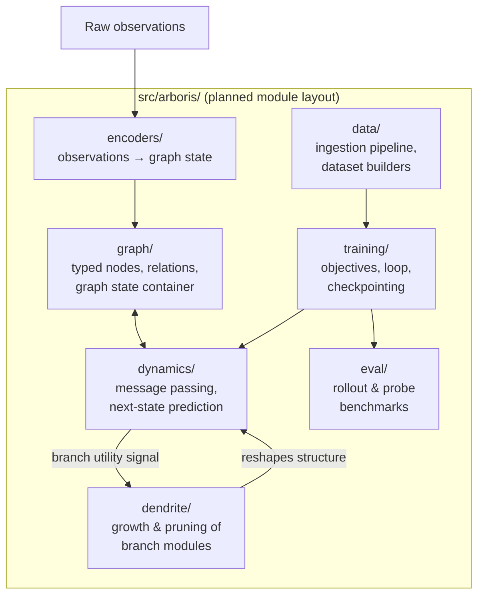
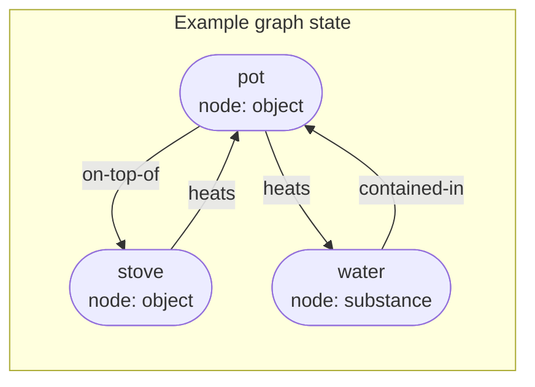
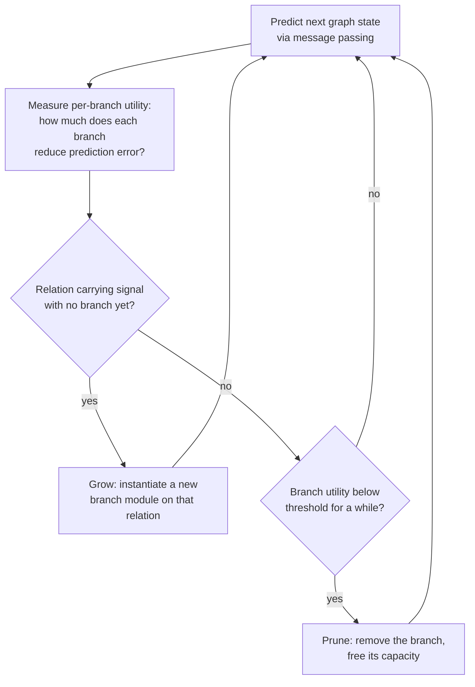

# Arboris architecture

> **Status:** planned design, pre-alpha. The component map below describes the
> intended shape of `src/arboris/`; today the package is a scaffold and these
> modules are being built out. This document is the reference the code is
> converging toward.

## The core idea, twice

**In plain terms:** imagine trying to predict what happens next in a kitchen.
One approach is to take a photo, compress it into a single summary number
sequence, and learn to predict the next summary. Arboris instead keeps a live
map: *the pot is on the stove, the stove is on, the water is in the pot*. To
predict, it follows the connections that matter (stove → heat → water) and
ignores the ones that don't (the color of the curtains). When a connection
keeps proving useful for prediction, Arboris grows more structure around it —
a new branch. When a branch stops earning its keep, it gets pruned. The model's
*shape* adapts to the world it is modeling.

**For researchers:** Arboris maintains state as a typed, attributed graph
G = (V, E) where nodes are entity slots and edges are typed relations. Dynamics
are computed by message passing over this graph rather than by rolling a fixed
latent forward. The distinctive mechanism is **dendritic growth**: the model's
computational graph is not fixed at initialization. Branch modules are
instantiated along relations whose messages carry predictive signal (measured
as marginal reduction in prediction loss when the branch is active), and pruned
when their contribution decays. Capacity is therefore allocated by the
structure of the environment, not by a uniform width hyperparameter.

## Component map

The library is organized so that each concern — representing state, growing
structure, encoding observations, predicting dynamics — lives in its own
module.

| Module | Responsibility | Plain-terms version |
|---|---|---|
| `graph/` | Graph state container: typed node and edge sets, attribute tensors, incremental updates | The map itself: the things and their connections |
| `encoders/` | Turn raw observations into nodes, edges, and attribute updates on the graph | The eyes: what it sees becomes entries on the map |
| `dynamics/` | Message passing over the graph to predict the next state | The imagination: following connections to guess what happens next |
| `dendrite/` | Decide where to grow new branch modules and which to prune, from branch utility statistics | The gardener: grows branches that help, trims ones that don't |
| `data/` | The [data ingestion pipeline](data-pipeline.md) and dataset builders | The kitchen that prepares the training material |
| `training/` | Objectives, optimization loop, checkpointing — the [training pipeline](training-pipeline.md) | The school where the model learns |
| `eval/` | Rollout accuracy and structure-probe benchmarks | The exams |

## Graph state

State is a typed graph rather than a flat vector. Nodes carry attribute
vectors; edges carry a relation type and their own attributes.

Because state is factored into entities and relations, a prediction error can
be localized — *which* entity or relation was mispredicted — instead of being
smeared across a monolithic latent. That localization is exactly the signal the
dendritic mechanism needs.

## The dendritic growth cycle

Growth and pruning run as a slow loop around the fast prediction loop:

**In plain terms:** the model constantly asks two questions. *Is there a
connection I keep using that deserves dedicated machinery?* If so, build it.
*Is there machinery I built that no longer helps?* If so, remove it. Over
training, the model's structure comes to mirror the structure of the
environment.

**For researchers:** this is a form of learned structural sparsity with a
growth operator, related in spirit to progressive networks and neural
architecture search but driven online by a local utility signal (marginal loss
reduction attributable to a branch) rather than by an outer search loop. The
design questions under active exploration — and the reason the architecture is
pre-alpha — include the utility estimator (counterfactual gating vs. gradient
attribution), growth budgets, and stability of the grow/prune equilibrium.

## Where the openness commitments touch the architecture

Every module above is Apache-2.0 in this repository. The `data/` module is
written so the open dataset is *rebuildable* from the recipe, and `training/`
checkpoints in a format publishable directly as open weights. See
[openness.md](openness.md) for the full breakdown.
