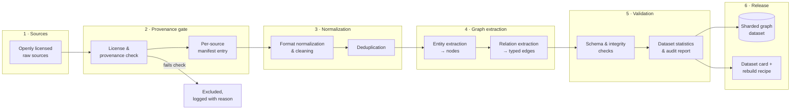

# Data ingestion pipeline

> **Status:** designed, not yet implemented. This document specifies the
> pipeline that `src/arboris/data/` will implement. It is published ahead of
> the code so the openness guarantees are on record from the start.

## Purpose

The data pipeline turns raw, openly licensed source material into the
graph-structured dataset the [training pipeline](training-pipeline.md)
consumes. It works so that **anyone can rebuild the entire dataset** from
public sources and this repository's code. The dataset for the base iteration
is an open release, not just an internal artifact.

**In plain terms:** before the model can learn, someone must prepare its study
material: collect it, clean it, check it, and organize it. This pipeline is
that preparation, and every step of it is public. The public record covers
which sources we used, what we filtered out and why, and how material becomes
the map-like format
Arboris learns from. If you re-run the pipeline, you get the same dataset we
trained on.

## Pipeline overview

## Stage by stage

### 1 · Sources

Only material whose license permits redistribution in an open dataset is
eligible. The source list itself is part of the release; the base iteration
has no undisclosed sources. Candidate sources under evaluation include openly
licensed structured vocabularies such as [schema.org](https://schema.org)
(CC BY-SA) and the ontologies in Microsoft's
[Ontology-Playground](https://github.com/microsoft/Ontology-Playground)
catalogue. Both are already part of the evaluation testbed
(`.claude/skills/ontology-testbed/`). The testbed also tests graph extraction
and provenance handling before a source enters the training dataset.

### 2 · Provenance gate

Every candidate source passes a license and provenance check **before** any
processing. Each admitted source gets a manifest entry recording origin,
license, retrieval date, and content hash. The pipeline logs rejected sources
with the reason, so the exclusion decisions are auditable too. *In plain
terms: nothing gets into the study material unless we can show where it came
from and that we're allowed to share it.*

### 3 · Normalization

The pipeline converts admitted material to a common format, cleans it
(encoding fixes, boilerplate stripping), and deduplicates it. Deduplication
keeps repeated content from getting repeated weight during training.

### 4 · Graph extraction

Graph extraction makes the dataset Arboris-shaped: the pipeline converts
normalized records into graphs. Entities become typed nodes; relations
between them become typed edges. The extraction rules are code in this
repository, not a manual process, so they are versioned and reproducible.
*In plain terms: raw material becomes little maps of "things and how they
relate," which is the format the model actually studies.*

### 5 · Validation

The pipeline checks every extracted graph against the schema: valid node/edge
types, no dangling references. It also compiles dataset-level statistics —
size, type distributions, source composition — into an audit report. The
audit report ships with the release.

### 6 · Release

The pipeline shards the validated graphs for efficient training and publishes
them as the open dataset. The release includes a dataset card describing
composition and known limitations. It also records the exact pipeline version
(git commit) that produced the dataset.

## Reproducibility contract

The base-iteration dataset release always includes:

| Artifact | Why it matters |
|---|---|
| The sharded dataset itself | Train without re-running ingestion |
| Source manifest (origins, licenses, hashes) | Verify provenance of every input |
| The pipeline code version (git commit) | Rebuild the dataset from scratch |
| Audit report (statistics, exclusions) | Understand composition and gaps |
| Dataset card | Intended use and known limitations |

The contract above is the "open data" pillar described in
[openness.md](openness.md). Open means *rebuildable and auditable*, not merely
downloadable.
