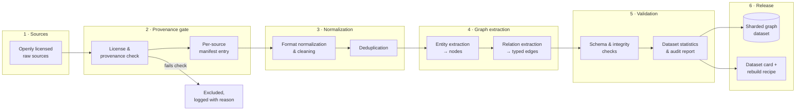

# Data ingestion pipeline

> **Status:** designed, not yet implemented. This document specifies the
> pipeline that `src/arboris/data/` will implement. It is published ahead of
> the code so the openness guarantees are on record from the start.

## Purpose

The data pipeline turns raw, openly licensed source material into the
graph-structured dataset the [training pipeline](training-pipeline.md)
consumes — and does so in a way that the **entire dataset can be rebuilt by
anyone** from public sources and this repository's code. The dataset for the
base iteration is an open release, not just an internal artifact.

**In plain terms:** before the model can learn, its study material has to be
collected, cleaned, checked, and organized. This pipeline is that process, and
every step of it is public: which sources were used, what was filtered out and
why, and how the material was converted into the map-like format Arboris
learns from. If you re-run the pipeline, you get the same dataset we trained on.

## Pipeline overview

## Stage by stage

### 1 · Sources
Only material whose license permits redistribution in an open dataset is
eligible. The source list itself is part of the release — there are no
undisclosed sources in the base iteration.

### 2 · Provenance gate
Every candidate source passes a license and provenance check **before** any
processing. Each admitted source gets a manifest entry recording origin, license,
retrieval date, and content hash. Rejected sources are logged with the reason,
so the exclusion decisions are auditable too. *Plain terms: nothing gets into
the study material unless we can show where it came from and that we're allowed
to share it.*

### 3 · Normalization
Admitted material is converted to a common format, cleaned (encoding fixes,
boilerplate stripping), and deduplicated so repeated content doesn't get
repeated weight during training.

### 4 · Graph extraction
The step that makes this dataset Arboris-shaped: normalized records are
converted into graphs. Entities become typed nodes; relationships between them
become typed edges. The extraction rules are code in this repository, not a
manual process, so they are versioned and reproducible. *Plain terms: raw
material becomes little maps of "things and how they relate," which is the
format the model actually studies.*

### 5 · Validation
Every extracted graph is checked against the schema (valid node/edge types,
no dangling references), and dataset-level statistics — size, type
distributions, source composition — are compiled into an audit report that
ships with the release.

### 6 · Release
The validated graphs are sharded for efficient training and published as the
open dataset, alongside a dataset card describing composition and known
limitations, plus the exact pipeline version (git commit) that produced it.

## Reproducibility contract

The base-iteration dataset release always includes:

| Artifact | Why it matters |
|---|---|
| The sharded dataset itself | Train without re-running ingestion |
| Source manifest (origins, licenses, hashes) | Verify provenance of every input |
| The pipeline code version (git commit) | Rebuild the dataset from scratch |
| Audit report (statistics, exclusions) | Understand composition and gaps |
| Dataset card | Intended use and known limitations |

This is the "open data" pillar described in [openness.md](openness.md):
open means *rebuildable and auditable*, not merely downloadable.
