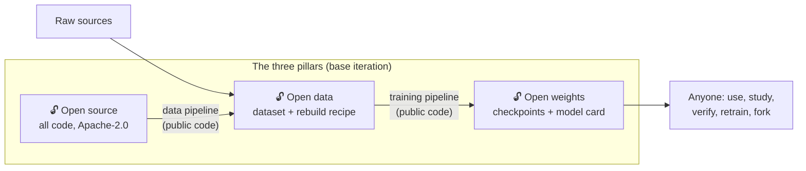

# Openness: source, weights, and data

Arboris commits to full openness on **three axes** for the base iteration of
the model. Many projects are open on one axis and closed on the others — open
code with secret data, or downloadable weights with an undisclosed recipe.
Arboris treats the three as a single reproducibility chain: **you should be
able to retrace the whole path from raw sources to a working model using only
public artifacts.**

**In plain terms:** you can read every line of the instructions (source), see
every page of the study material (data), and download the finished student
(weights). Nothing about how the base model came to be is a secret.

---

## Pillar 1 — Open source

**What:** every line of code the project produces — the architecture
(`graph/`, `dendrite/`, `dynamics/`, `encoders/`), the
[data pipeline](data-pipeline.md) (`data/`), the
[training pipeline](training-pipeline.md) (`training/`), and the evaluation
suite (`eval/`).

**Where:** this repository, <https://github.com/AdamPippert/Arboris>.

**License:** [Apache-2.0](../LICENSE) — a permissive license allowing
commercial use, modification, and redistribution, with an explicit patent
grant. See also [`NOTICE`](../NOTICE).

**Why it matters:** for a researcher, the code *is* the precise specification
of the method — no ambiguity between what a paper says and what was run. For
everyone else: nothing the model does is hidden machinery; anyone qualified can
inspect exactly how it works.

**Status:** the repository is public from day one, pre-alpha scaffold included.
Development happens in the open rather than being released after the fact.

---

## Pillar 2 — Open data

**What:** the complete training dataset for the base iteration **and** the
recipe to rebuild it: the source manifest (origins, licenses, content hashes),
the ingestion code, and the audit report of what was included and excluded and
why. See [data-pipeline.md](data-pipeline.md) for the full pipeline and its
reproducibility contract.

**Where:** published alongside the model release with a dataset card.

**Why it matters:** data is the axis most often left closed, and it is the one
that makes results actually reproducible. Open data means a researcher can
check for contamination, measure composition effects, or rebuild a variant —
and a layperson can literally see what the model studied. Provenance is
enforced *before* processing (the pipeline's license gate), not audited after.

**Status:** in design; the pipeline specification is public ahead of the
implementation so the guarantees are on record first.

---

## Pillar 3 — Open weights

**What:** the trained checkpoints of the base model — parameters **plus** the
dendritically grown structure (which, in Arboris, is part of what training
produces) — with the training config, the exact dataset version consumed,
evaluation results, and a model card documenting capabilities and limitations.
See [training-pipeline.md](training-pipeline.md) for what a checkpoint bundles.

**Where:** Hugging Face,
<https://huggingface.co/CoastalDigitalResearch/Arboris>, published by Coastal
Digital Research.

**Why it matters:** open weights make the model a usable artifact, not just a
described one — researchers can probe the grown structure directly (in a
dendritic model, the learned *shape* is itself a scientific result), and
practitioners can run, fine-tune, or fork it without gatekeeping.

**Status:** no weights released yet; the base iteration's checkpoints will be
published when training runs complete and pass the evaluation bar.

---

## Scope and honesty notes

- **"Base iteration"** means the first trained release of Arboris: its code,
  its dataset, and its weights are all open as described above. Future
  iterations are expected to follow the same policy for artifacts published
  under this project, but the commitment stated here is for the base iteration.
- **Pre-alpha means pre-alpha:** today the code is a scaffold and the dataset
  and weights do not exist yet. This document states commitments and design,
  published deliberately *before* the artifacts, so the project can be held to
  them.

## Summary table

| Axis | Artifact | License / terms | Home | Status |
|---|---|---|---|---|
| Source | Architecture, pipelines, eval code | Apache-2.0 | This repo | Scaffold public, in development |
| Data | Base dataset + manifest + rebuild recipe + audit report | Open release with per-source provenance | With model release | In design |
| Weights | Base checkpoints + grown structure + configs + model card | Open release | [Hugging Face](https://huggingface.co/CoastalDigitalResearch/Arboris) | Pending training |
