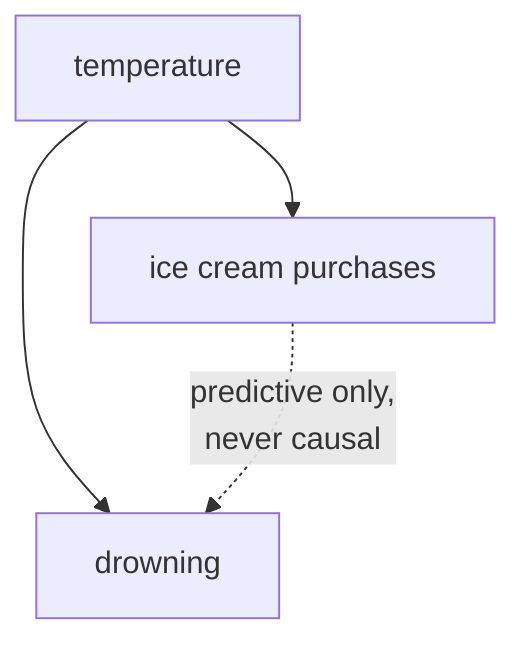
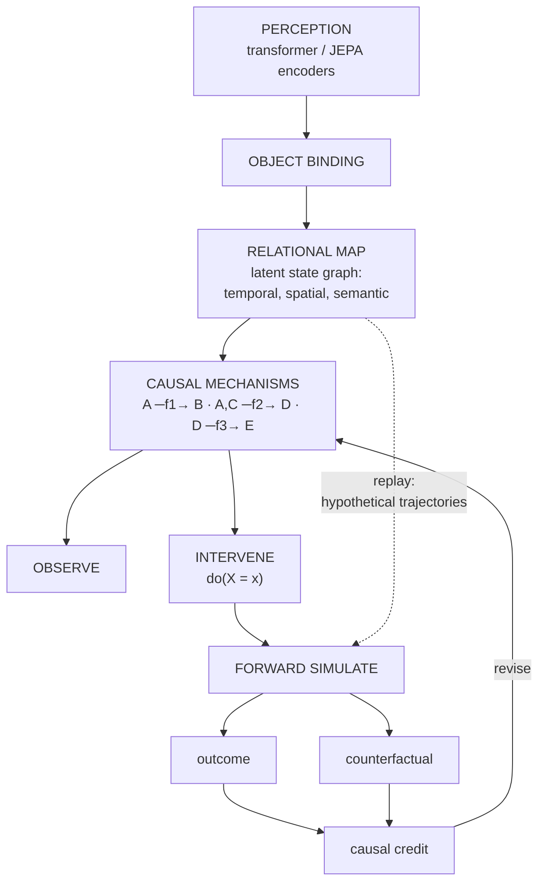

# RFC-0003: Causal information manipulation

**Status:** Draft (proposed, not implemented) · relates to ADR-0001, RFC-0001, RFC-0002
Requirement keywords (MUST, SHOULD, MAY) follow RFC 2119.

This Request for Comments (RFC) proposes causal computation as an Arboris
subsystem. It specifies a causal edge taxonomy, a mechanism node, an
intervention operator, a counterfactual/replay engine, and a falsification
benchmark. The goal is a system that answers "what would happen if I changed
X?" by simulation, not by linguistic imitation.

## Premise

A system built from pattern-learning components can implement causal
reasoning. Observational next-token prediction does not by itself force a
model to discover causal mechanisms. The missing ingredient is not a
different kind of neuron. The missing ingredient is an architecture and
learning process that distinguishes observation, intervention, consequence,
and counterfactual simulation.

The three levels differ formally:

| Level | Question | Form |
|---|---|---|
| Association | What co-occurs with X? | $P(Y \mid X{=}x)$ |
| Intervention | What happens if I set X? | $P(Y \mid \operatorname{do}(X{=}x))$ |
| Counterfactual | What would have happened? | $P(Y_{X=x} \mid X{=}x', Y{=}y')$ |

A capable sequence model masters the first level. The second and third
levels need a *mechanism*, not merely a representation. Instead of encoding
an association $A \leftrightarrow B$, the graph encodes an executable
function $B := f_B(A, U_B)$. Here $f_B$ is a separately manipulable
mechanism, and $U_B$ represents exogenous factors.

## Design principles

- **P1 — Predictive is not causal.** A causal edge MUST carry intervention
  evidence or a sufficiently strong causal identification. Correlation
  alone MUST NOT promote an edge to causal.
- **P2 — Mechanisms are modular.** Each causal relation SHOULD be a small,
  separately manipulable module (the independent causal mechanisms
  principle). An intervention replaces or clamps one variable or mechanism
  and propagates consequences. It never retrains the whole model.
- **P3 — Intervention is a computational primitive.** The world model MUST
  accept $\hat{s}_{t+1} = F(s_t, \operatorname{do}(a_t))$, not only
  $\hat{s}_{t+1} = F(s_t)$. The system MUST record which transitions the
  agent caused.
- **P4 — Causality is contextual.** Causal edges MUST carry validity
  contexts and known confounders. Ice cream purchases predict drowning;
  temperature causes both. The graph MUST be able to represent the fork
  rather than the spurious arrow.
- **P5 — Separation of concerns holds.** Retrieval assembles evidence
  (ADR-0001). Mechanisms simulate. Reasoning consumes both. No layer
  absorbs another's job.

## Edge taxonomy

The typed semantic graph gains a four-way edge distinction:

| Edge kind | Meaning | Example | Promotion requirement |
|---|---|---|---|
| Semantic | similarity / is-a | robin → bird | ontology or definition |
| Temporal | precedes | ignition → combustion | observed ordering |
| Predictive | predicts | smoke → fire | observational statistics |
| Causal | intervention changes | ignition → combustion | intervention evidence (P1) |

Proposed edge record (extends the current fixture edge schema):

```
edge {
    source
    target
    relation_type            # semantic | temporal | predictive | causal
    observational_strength   # association-level evidence
    intervention_strength    # do()-level evidence
    counterfactual_consistency
    confounders[]            # known common causes
    contexts[]               # where the relation holds
    mechanism_id             # executable mechanism, if causal
    confidence
}
```

The confounder fork, concretely:



## Mechanism nodes

A mechanism node makes an edge executable:

```
mechanism {
    id
    inputs[]        # parent variables
    output          # child variable
    fn              # learned module: output := fn(inputs, exogenous)
    exogenous       # U-variables the mechanism does not explain
    contexts[]      # validity conditions
    provenance      # observational | interventional | told
    calibration     # predicted-vs-observed intervention outcomes
}
```

A dendrite in this design does not represent "things related to
combustion". It represents
$\text{fuel} + \text{oxygen} + \text{ignition} \xrightarrow{M_{comb}} \text{heat} + \text{products}$.
The system can invoke, inhibit, substitute, compose, and test that
mechanism. Graph traversal along mechanism edges therefore stops being
retrieval. Traversal becomes simulation.

Interchange interventions (from causal-abstraction research) give the test
machinery: manipulate an internal variable, and check whether behavior
matches the causal model's prediction. Mechanisms that fail the check lose
`calibration` and eventually get pruned — the same utility-driven
grow/prune cycle the dendritic training loop already uses
(docs/training-pipeline.md).

## The intervention operator

`do(X = x)` on a graph state:

1. Clamp variable X to value x.
2. Sever X's incoming mechanism edges (X no longer listens to its parents).
3. Forward-simulate descendants through their mechanisms.
4. Record the trajectory with an `intervened` mark.

Counterfactual evaluation composes three steps:

1. **Abduction.** From an observed episode, infer the exogenous factors U.
2. **Intervention.** Apply `do(X = x)` in the abducted state.
3. **Prediction.** Forward-simulate; compare against the factual outcome.

## Learning loop

The loop changes shape from `predict → compare → gradient` to:

```
hypothesize → intervene → observe → assign causal credit → revise mechanism
```



Two Arboris components already fit this loop:

- **Dendritic credit assignment.** Different dendritic branches can host
  competing explanatory mechanisms for the same consequence. The soma
  integrates them. Feedback tells each branch whether its mechanism
  predicted the consequence, locally — not through a global gradient. The
  per-branch utility statistics in docs/training-pipeline.md are exactly
  the causal-credit signal this loop needs.
- **Replay.** The relational map supports successor-style predictive
  topology: a state is partly characterized by the states expected to
  follow it. Replay composes trajectories the agent never experienced and
  feeds them to the simulator as hypotheticals.

## Integration with existing components

| Component | Role in causal computation |
|---|---|
| Transformer / JEPA encoders | perception and object binding; object-level masking induces latent interventions (see Evidence base) |
| Typed semantic graph | hosts all four edge kinds; schema above |
| SGJM (the predictive world model) | hosts mechanism nodes; runs forward simulation |
| Dendritic fabric | routes activation (RFC-0002); assigns per-branch causal credit |
| Retrieval subsystem | supplies evidence graphs; `causes` edges already carry distinct conductance (RFC-0002) |
| Executive layer | selects which experiments (interventions) to run |
| Ontology testbed | grows an interventional benchmark track (below) |

The retrieval consequence is immediate: `relation_type` and
`intervention_strength` become scoring channels, and activation conductance
can differ for causal versus merely predictive edges. No retrieval
interface changes; the fields ride the existing edge payload.

## Benchmark and falsification

The design MUST be falsifiable. The experiment:

1. Construct environments with deliberate correlation/causation inversions
   and distribution shifts. Extend the testbed fixture format with
   interventional trajectories: `(state, do(action), state')` triples plus
   held-out intervention and counterfactual queries.
2. Train Arboris and an equivalently sized sequence/world-model baseline on
   the same observational and interventional data.
3. Evaluate on unseen interventions and counterfactuals, especially after
   the training correlations are reversed.

Metrics: interventional accuracy, counterfactual consistency, and
post-reversal generalization gap.

IF Arboris does not outperform the baseline on unseen interventions and
counterfactuals,
THEN the causal graph machinery is not justified.
The project MUST then revise or abandon this RFC's direction.

## Evidence base

Rule 10.2 note: the results below are **reported** by their sources and
summarized from the originating design discussion. The project has not yet
independently reproduced them. Verify before load-bearing use.

- **Causal-JEPA** (Nam, Le Lidec, Maes, LeCun, Balestriero; reported 2026):
  object-centric JEPA (Joint-Embedding Predictive Architecture) that masks
  whole objects rather than random patches. Reported effects: latent
  interventions with counterfactual-like behavior, plus more efficient
  latent-space planning. The reported gain on counterfactual reasoning is
  about 20 percentage points over the same architecture without
  object-level masking.
- **Hippocampal cognitive maps**: reported evidence that the
  hippocampal/entorhinal system builds relational maps of spatial,
  conceptual, and abstract spaces. The maps show successor-representation
  structure:
  $M(s,s') = E[\sum_t \gamma^t \mathbf{1}(s_t{=}s') \mid s_0{=}s]$.
  Reported 2025 work: maps composed from reusable cortical building blocks
  during replay, enabling latent learning and fast generalization.
- **Dendritic instructive signals** (reported 2026, Nature): cortical
  dendrites carry vectorized reward/error information; disrupting the
  signals impairs learning. Feed-forward and feedback information can be
  spatially separated across neuronal compartments, without
  backpropagation's temporally separated passes.
- **Prospective configuration**: a network first infers what its activity
  should become, then consolidates the matching synaptic changes. Reported
  to reproduce biological learning phenomena and solve credit assignment
  without conventional backpropagation.
- **Causal abstraction / interchange interventions**: machinery for testing
  whether internal neural variables behave like variables in a causal
  model.

## Non-goals

- Replacing transformers. Encoders remain the perceptual and semantic
  substrate; the causal machinery lives in the graph and the SGJM.
- Causal discovery from purely observational text. P1 forbids promoting
  correlations to causal edges without intervention evidence.
- Implementing this RFC now. The retrieval subsystem (RFC-0001/0002) and
  the interventional benchmark track come first; mechanisms follow.

## Open questions

- Mechanism representation: small learned networks per mechanism, shared
  networks with mechanism embeddings, or symbolic forms where identifiable?
- Abduction: how much exogenous state must the system infer before
  counterfactuals become useful, and how is that inference scored?
- Promotion thresholds: how much intervention evidence converts a
  predictive edge to a causal edge, and how do edges demote when contexts
  shift?
- Confounder discovery: when should the system hypothesize an unobserved
  common cause instead of a direct edge?
- Benchmark scope: which testbed ontologies can gain synthetic dynamics
  (mechanisms with known ground truth) so causal credit is checkable?
