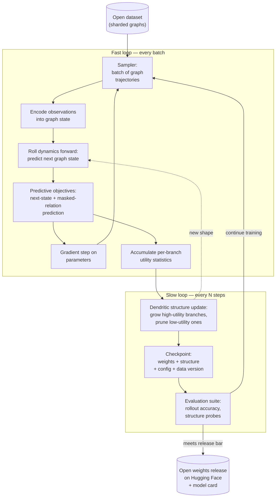

# Training pipeline

> **Status:** designed, not yet implemented. This document specifies the
> pipeline that `src/arboris/training/` will implement, from the open dataset
> to published open weights.

## Purpose

The training pipeline consumes the [open dataset](data-pipeline.md) and
produces the model checkpoints that are released as open weights on
Hugging Face. Like the data pipeline, it is designed to be reproducible end to
end: configs, code, and logs for the base iteration are public.

**In plain terms:** this is the school. The model is shown situations from the
dataset, tries to predict what comes next, and is corrected when it's wrong.
Uniquely for Arboris, the model doesn't just adjust its answers — it also
adjusts its *shape*, growing new branches where they help predictions and
trimming ones that don't. Periodically it takes exams, and the versions that
pass are published for anyone to download.

## Pipeline overview

Two nested loops: a **fast loop** that updates the model's parameters every
batch, and a **slow loop** that periodically updates the model's structure,
evaluates, and checkpoints.

## Stage by stage

### Sampling
Batches of graph trajectories — sequences of graph states over time — are drawn
from the sharded dataset. The sampler records exactly which dataset version
(shard hashes) it consumed, so every checkpoint is traceable to its data.

### Encoding and rollout
Observations are encoded into the typed graph state, and the dynamics module
rolls the state forward by message passing to predict the next state. See
[architecture.md](architecture.md) for the mechanism.

### Objectives
Training is self-supervised — no labels, just prediction:

- **Next-state prediction:** given the graph now, predict the graph at the next
  step (node attributes and edge changes).
- **Masked-relation prediction:** hide some edges and require the model to
  infer them from the rest of the graph, forcing it to internalize relational
  regularities rather than memorize sequences.

*Plain terms: the model plays two games — "guess what happens next" and "guess
the hidden connection" — and gets better at both by being corrected.*

### The structure update (the dendritic part)
During the fast loop, per-branch utility statistics accumulate: how much each
branch actually contributes to reducing prediction error. Every N steps the
slow loop acts on them — growing new branch modules on relations that carry
unexploited signal and pruning branches whose utility has decayed. This is the
step that distinguishes the Arboris training loop from a standard world-model
loop: **capacity is reallocated during training** rather than fixed at
initialization.

### Checkpointing
A checkpoint is more than weights. Because the model's structure changes during
training, each checkpoint bundles: parameters, the grown graph structure, the
full training config, and the dataset version. Any checkpoint is therefore
independently loadable and auditable.

### Evaluation
Checkpoints run an evaluation suite: multi-step rollout accuracy (how far
predictions stay faithful) and structure probes (does the grown graph reflect
real relations in held-out environments?). Results are logged publicly for the
base iteration.

### Release
Checkpoints that meet the release bar are published to
[Hugging Face](https://huggingface.co/CoastalDigitalResearch/Arboris) with a
model card documenting training data (the open dataset version), configs,
evaluation results, and limitations — the "open weights" pillar of
[openness.md](openness.md).

## Reproducibility contract

For every released checkpoint of the base iteration:

| Artifact | Public? |
|---|---|
| Weights + grown structure | ✅ Hugging Face |
| Training config (hyperparameters, growth schedule) | ✅ this repo / release |
| Exact dataset version consumed | ✅ recorded in checkpoint metadata |
| Training + eval code version (git commit) | ✅ recorded in checkpoint metadata |
| Evaluation results | ✅ model card |

Given the open dataset and this repository, a third party can retrain a
comparable model or verify a released one.
