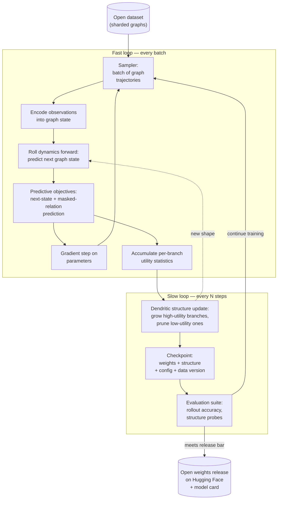

# Training pipeline

> **Status:** designed, not yet implemented. This document specifies the
> pipeline that `src/arboris/training/` will implement, from the open dataset
> to published open weights.

## Purpose

The training pipeline consumes the [open dataset](data-pipeline.md) and
produces the model checkpoints released as open weights on Hugging Face. Like
the data pipeline, it is designed to be reproducible end to end: configs,
code, and logs for the base iteration are public.

**In plain terms:** this is the school. The model sees situations from the
dataset, tries to predict what comes next, and gets corrected when it is
wrong. Uniquely for Arboris, the model adjusts more than its answers. It also
adjusts its *shape*: it grows new branches where they help predictions and
trims ones that don't. Periodically it takes exams, and the project publishes
the versions that pass for anyone to download.

## Pipeline overview

The pipeline runs two nested loops. A **fast loop** updates the model's
parameters every batch. A **slow loop** periodically updates the model's
structure, evaluates, and checkpoints.

## Stage by stage

### Sampling

The sampler draws batches of graph trajectories — sequences of graph states
over time — from the sharded dataset. It records exactly which dataset
version (shard hashes) it consumed, so every checkpoint is traceable to its
data.

### Encoding and rollout

The encoders turn observations into the typed graph state. The dynamics
module rolls the state forward by message passing to predict the next state.
See [architecture.md](architecture.md) for the mechanism.

### Objectives

Training is self-supervised — no labels, just prediction:

- **Next-state prediction:** given the graph now, predict the graph at the
  next step (node attributes and edge changes).
- **Masked-relation prediction:** hide some edges and require the model to
  infer them from the rest of the graph. Inferring hidden edges forces the
  model to internalize relational regularities rather than memorize sequences.

*In plain terms: the model plays two games — "guess what happens next" and
"guess the hidden connection." Correction makes it better at both.*

### The structure update (the dendritic part)

During the fast loop, per-branch utility statistics accumulate: how much each
branch actually contributes to reducing prediction error. Every N steps, the
slow loop acts on the statistics. It grows new branch modules on relations
that carry unexploited signal and prunes branches whose utility has decayed.
This step distinguishes the Arboris training loop from a standard world-model
loop: **the loop reallocates capacity during training** rather than fixing it
at initialization.

### Checkpointing

A checkpoint is more than weights. Because the model's structure changes
during training, each checkpoint bundles: parameters, the grown graph
structure, the full training config, and the dataset version. Any checkpoint
is therefore independently loadable and auditable.

### Evaluation

Checkpoints run an evaluation suite. The suite measures multi-step rollout
accuracy: how far predictions stay faithful. It also runs structure probes:
does the grown graph reflect real relations in held-out environments? The
project logs results publicly for the base iteration.

### Release

Coastal Digital Research publishes checkpoints that meet the release criteria
to [Hugging Face](https://huggingface.co/CoastalDigitalResearch/Arboris).
Each release ships with a model card documenting training data (the open
dataset version), configs, evaluation results, and limitations. The release
fulfills the "open weights" pillar of [openness.md](openness.md).

## Reproducibility contract

For every released checkpoint of the base iteration:

| Artifact | Public? |
|---|---|
| Weights + grown structure | ✅ Hugging Face |
| Training config (hyperparameters, growth schedule) | ✅ this repo / release |
| Exact dataset version consumed | ✅ recorded in checkpoint metadata |
| Training + eval code version (git commit) | ✅ recorded in checkpoint metadata |
| Evaluation results | ✅ model card |

Given the open dataset and this repository, a third party can retrain a
comparable model or verify a released one.
